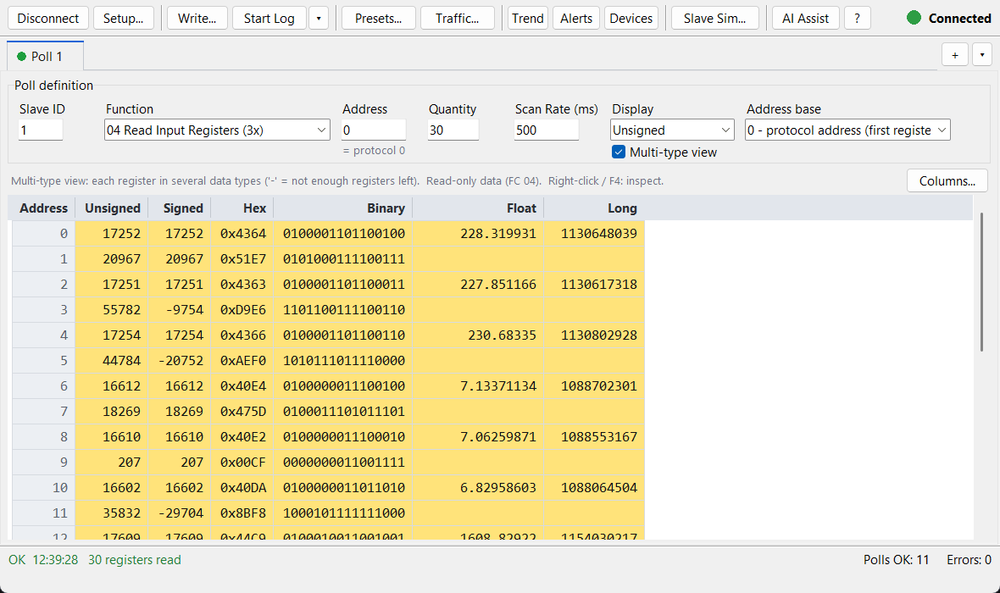
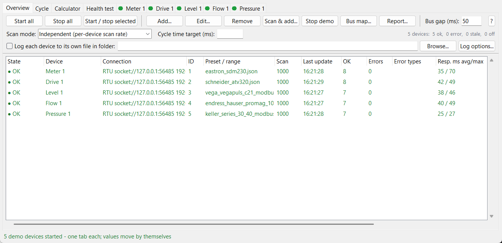
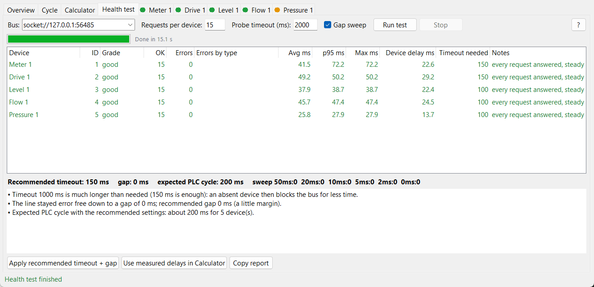
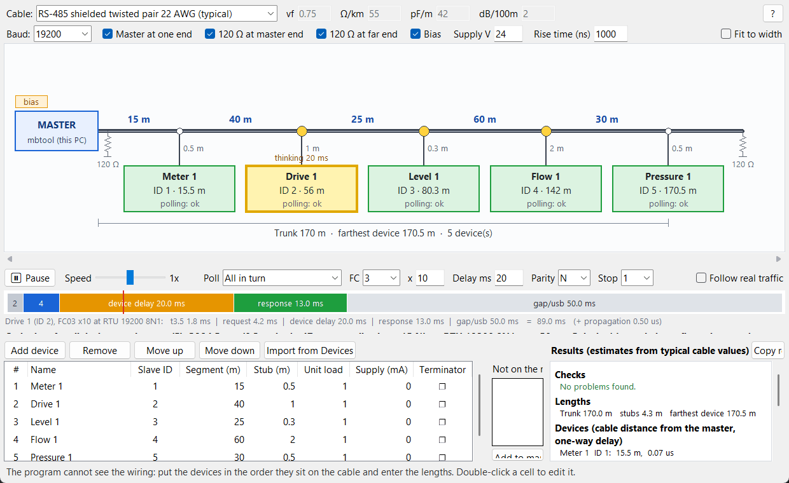

# mbtool - Modbus master, slave simulator and RS-485 bus design tool

Read, write, simulate and analyse Modbus devices (TCP / RTU / ASCII) and design the RS-485 bus - one Windows program,
with an MCP server so AI assistants can help. Free and open source (MIT).

## ⬇ Download (Windows 10 / 11)

**Just want to use it? Download one file - you do not need anything else in this repository.**

| I want to... | Download |
|---|---|
| **Install it** (Start menu shortcut, uninstall from Apps & features, no admin rights) | [**mbtool-setup.exe**](https://github.com/tomored88/mbtool-modbus/releases/latest/download/mbtool-setup.exe) |
| **Run it without installing** (unzip anywhere, e.g. a USB stick) | [**mbtool-portable.zip**](https://github.com/tomored88/mbtool-modbus/releases/latest/download/mbtool-portable.zip) |
| **Read what it can do first** (feature sheet, 3 pages with screenshots, PDF) | [**English**](https://github.com/tomored88/mbtool-modbus/releases/latest/download/mbtool-feature-sheet-en.pdf) · [**ไทย**](https://github.com/tomored88/mbtool-modbus/releases/latest/download/mbtool-feature-sheet-th.pdf) |

All versions and release notes: [Releases](https://github.com/tomored88/mbtool-modbus/releases/latest). The program is not code-signed, so Windows SmartScreen may warn
the first time: **More info > Run anyway**. After installing, `mbtool-cli.exe selftest` checks it on your PC in about
15 seconds, no hardware needed.

Manual: built in (press **F1**, Thai and English).

### Windows says the program is unsafe?

mbtool is new and not code-signed, so Windows has no reputation for it yet:

- **"Windows protected your PC" (SmartScreen):** click **More info**, then **Run anyway**. This appears once.
- **Microsoft Defender says it found a threat:** programs packed with PyInstaller are sometimes flagged by mistake.
  Compare the file's SHA-256 with the one in the [release notes](https://github.com/tomored88/mbtool-modbus/releases/latest) (PowerShell: `Get-FileHash mbtool-setup.exe`),
  or run from source instead (`install.bat`, then `run.bat`). Please report it in Issues so it can be submitted to
  Microsoft as a false positive.

## Screenshots

**Main window** - live register table, every register shown as several data types side by side



**Devices** - several devices on one RS-485 line, each with its own tab, error types and response times



**Bus health test** - real response times per device, recommended timeout and gap, expected PLC cycle



**RS-485 bus map** - cable lengths, terminators and a request travelling to a device and back



## What is in this repository

| Folder / file | Contents |
|---|---|
| `src/` | the program (Python): `mbtool.py` is the main program, the other files are its modules |
| `help/` | the built-in manual (Thai in `help/`, English in `help/en/`) |
| `presets/` | device register maps (JSON) - the library of 30 models is UNVERIFIED |
| `docs/` | feature sheets and sample commissioning reports |
| `tests/` | automated tests (`python -m pytest tests`) |
| `packaging/` | build scripts for the .exe, installer and portable zip (`packaging\build_exe.bat`) |
| `run.bat`, `install.bat` | run from source with Python (developers) |

## Features

Overview on 3 pages with screenshots: [feature sheet (English)](https://github.com/tomored88/mbtool-modbus/releases/latest/download/mbtool-feature-sheet-en.pdf) · [ไทย](https://github.com/tomored88/mbtool-modbus/releases/latest/download/mbtool-feature-sheet-th.pdf)


- **Master:** Modbus/TCP, RTU, ASCII; function codes 01-06, 15, 16, 22, 23; 10 display formats.
- **GUI** (tkinter): poll tabs (several polls open at once in the main window, like several poll windows: own
  Slave ID / function / range / scan rate / display and optionally own connection each, Ctrl+T / Ctrl+W), poll grid
  with rows-per-column, multi-type view (each register as Unsigned / Signed / Hex /
  Binary / Float / Long... side by side, editable per column), address base 0 / 1 / PLC (4xxxx), write dialog, value inspector (F4),
  preset view (F7), traffic monitor (F8), trend graph (F10), alerts, multi-device polling (F11), CSV logging with
  rotation, workspace files (.mbw), Slave Sim window.
- **Bus map** (Tools > Bus map, Ctrl+M): draw where each device sits on the RS-485 line (order, cable and stub lengths,
  terminators, bias); it estimates propagation delay, recommended max baud, critical length, unit loads and voltage drop,
  lists wiring warnings, and animates a request / response travelling along the line (or follows the real traffic).
  The program cannot see the wiring - the numbers are only as good as the map you enter. CLI: `python src/mbtool.py busmap map.json`.
- **Presets:** JSON register maps per device (`presets/`, 30 library files for meters, drives, inverters, sensors,
  I/O, level / pressure / flow). **Every library preset is UNVERIFIED** - they were written from public manuals and
  never tested on a real device. Compare the values with the device display before trusting them.
- **Slave simulator:** TCP, RTU and ASCII, optionally filled from a preset; software null-modem cable (`vcom`) so RTU
  can be tested without COM ports or drivers.
- **Scanner:** serial settings (baud/parity/stop/Slave ID), Slave IDs, readable register ranges, device
  identification (FC43/14, FC17) with preset suggestions. Read-only.
- **Test Center:** checks a slave against Modbus rules (exception codes, limits, timing); optional write tests.
- **Built-in manual** (F1, Thai and English): 85 searchable topics - function codes, exception codes, data types, address bases, serial settings, every GUI feature, preset fields, troubleshooting, glossary - with context help on each control. CLI: `python src/helpdocs.py search "exception 2"`.
- **MCP server** (`mbtool_mcp.py`): lets an AI read devices, take snapshots, scan and test. **Writes are disabled
  unless you enable them** (see below).

## Windows app details

The two downloads above ([Releases](https://github.com/tomored88/mbtool-modbus/releases/latest)):

- **`mbtool-setup.exe`** - GUI installer: pick the install folder, shortcuts, done (per-user, no admin). Scripted:
  `mbtool-setup.exe --silent --dir D:\Tools\mbtool`. Uninstall from Apps & features.
- **`mbtool-portable.zip`** - unzip anywhere (USB stick, shared folder) and run `mbtool.exe`. Settings, presets and
  logs stay in its `data\` folder (because of the `portable.txt` next to the exe); nothing is written to AppData or
  the registry.

- `mbtool.exe` = GUI. `mbtool-cli.exe` = console: `mbtool-cli.exe sim --port 5020`, `read ...`, and
  `mbtool-cli.exe mcp` (MCP server for AI tools; add `--http` to share).
- Installed copy: settings, edited presets, logs and the MCP audit log live in `%APPDATA%\mbtool`
  (Help > Open data folder). The bundled preset library is refreshed on each new version; your own files are kept.
- Unexpected errors are written to `logs\crash.log` and shown in a dialog instead of vanishing.
- Build both yourself: `packaging\build_exe.bat` (needs `pip install pyinstaller pillow`); output in `dist\`. The exe is unsigned, so Windows
  SmartScreen may warn on first run ("More info" > "Run anyway").

## Run from source (Windows, Python 3.10+)

```
install.bat          creates .venv and installs requirements
run.bat              starts the GUI
```

or manually: `pip install -r requirements.txt` then `python src/mbtool.py`.
Other systems: the code is plain Python; tkinter and pyserial are the only runtime needs for the GUI.

## Quick try without hardware

```
python src/mbtool.py sim --port 5020 --preset presets/example_generic_meter.json
python src/mbtool.py                         # GUI: F3 setup -> TCP 127.0.0.1:5020 -> Connect, F7 for the preset view
python src/mbtool.py preset-read tcp://127.0.0.1:5020 presets/example_generic_meter.json
```

RTU without hardware (software cable, the baud rate is not enforced):

```
python src/mbtool.py vcom --port 7000
python src/mbtool.py sim --serial socket://127.0.0.1:7000 -u 1 --baud 19200 --parity E
python src/mbtool.py read "serial:socket://127.0.0.1:7000?baud=19200&parity=E" -u 1 -f 3 -a 0 -n 5
```

In the GUI type `socket://127.0.0.1:7000` into the COM port box.

## Command line

```
python src/mbtool.py read|write|sim|vcom|preset-list|preset-read|preset-write ...
python src/scanner.py serial COM3 --units 1-10,247      find baud / parity / stop bits / Slave ID
python src/scanner.py ids URL | regs URL | identify URL
python src/testcenter.py tcp://host:502 -u 1 --addr 0   [--write --scratch 200]
python src/interpret.py --words 0x4348 0xCCCD           every interpretation of raw registers
```

URLs: `tcp://host:port` or `serial:COM3?baud=19200&parity=E&stop=1&mode=rtu` (mode `rtu` or `ascii`).

## MCP server

1. `pip install -r requirements.txt` (needs `mcp>=2`).
2. Register it in your client, for Claude Code a `.mcp.json` like `.mcp.json.example` (use absolute paths).
3. Writes are off by default. To allow them set in the server `env`:
   `MBTOOL_ALLOW_WRITE=1` and `MBTOOL_WRITE_ALLOW="1:3:100-110;1:0:0-7"` (unit:area:range; area 3 = holding registers,
   0 = coils). Preset writes also need a verified preset (or `MBTOOL_ALLOW_UNVERIFIED=1`).
   Drives and process instruments can move real machinery: only allow ranges you understand.

## Sharing with other people's AI (HTTP mode)

Besides the per-user stdio mode, the MCP server can be shared over HTTP so that someone else's AI client can read the
device that is connected to YOUR computer (read-only):

```
python src/mbtool_mcp.py --http --connect tcp://192.168.1.50:502            # this PC only (127.0.0.1:8765)
python src/mbtool_mcp.py --http --host 0.0.0.0 --allowed-host mypc.tailnet.ts.net:8765 --connect serial:COM3?baud=9600
```

It prints a random bearer token once; give it only to people you trust. Client side (Claude Code example):

```
claude mcp add --transport http modbus http://HOST:8765/mcp --header "Authorization: Bearer TOKEN"
```

Security model (all enforced by the server, tested in `tests/test_ai.py`):
- Token required for every request (constant-time compare); 10 wrong tokens in a minute lock the client out for a minute;
  rate limit per client.
- Binds to 127.0.0.1 unless you pass `--host`. Traffic is **plain HTTP** unless you use `--certfile/--keyfile`; across a
  network use a VPN such as Tailscale.
- Remote clients cannot choose targets: `connect`, `disconnect` and serial scans are refused unless `--allow-connect`.
- Writes are always disabled in HTTP mode unless you also pass `--allow-write` and set the write allowlist.
- Every tool call and failed login is appended to `~/.mbtool/mcp_audit.log` (the token is never logged).
- The AI gets `instructions` and the tools `diagnostic_report`, `interpret_registers`, `snapshot`, `scan_*`,
  `identify_device`, `test_center`, `preset_read`. For chat apps without MCP, the GUI "AI Assist" window (F12) can
  copy a diagnostic report to paste into any AI; the same window starts/stops the shared server using the GUI's own
  connection.

## Tests

```
python tests/test_core.py ; python tests/test_preset.py ; python tests/test_rtu.py ; python tests/test_library.py
python tests/test_datalog.py ; python tests/test_testcenter.py ; python tests/test_monitor.py ; python tests/test_scanner.py ; python tests/test_ai.py
python tests/test_help.py ; python tests/test_aiassist.py ; python tests/test_helpui.py
```

## Known limits

- Never tested on real COM ports or real devices (RTU/ASCII only over the software cable and a fake serial layer).
- SerialSlave has no data-bits setting (8 bits only); no compressed or rotated log retention beyond `max_files`.
- Preset schema cannot express all vendor quirks; see the `notes` and `source` fields in every library file.

---

## สรุปภาษาไทย

mbtool คือโปรแกรม Modbus บน Windows ใช้อ่าน เขียน จำลอง และวิเคราะห์อุปกรณ์ Modbus (TCP / RTU / ASCII)
รวมถึงออกแบบบัส RS-485 ได้ในโปรแกรมเดียว มี MCP server ให้ AI ช่วยวิเคราะห์ได้ ใช้ฟรีและเปิดโค้ด (MIT)

**ดาวน์โหลด (ไม่ต้องมี Python):**
- ต้องการติดตั้ง ใช้ [**mbtool-setup.exe**](https://github.com/tomored88/mbtool-modbus/releases/latest/download/mbtool-setup.exe)
- ไม่อยากติดตั้ง ใช้ [**mbtool-portable.zip**](https://github.com/tomored88/mbtool-modbus/releases/latest/download/mbtool-portable.zip) แตกไฟล์แล้วรัน `mbtool.exe` ได้เลย ใส่ USB ได้
- ไฟล์อื่นใน repo นี้เป็นโค้ด ไม่ต้องโหลด

**เอกสารแนะนำโปรแกรม (feature sheet):** [ภาษาไทย](https://github.com/tomored88/mbtool-modbus/releases/latest/download/mbtool-feature-sheet-th.pdf) · [English](https://github.com/tomored88/mbtool-modbus/releases/latest/download/mbtool-feature-sheet-en.pdf) (PDF 3 หน้า มีภาพหน้าจอ)

**Windows เตือนว่าไม่ปลอดภัย:** เป็นเพราะโปรแกรมยังไม่ได้ลงนามดิจิทัล ไม่ได้มีไวรัส (ไฟล์ใน release ผ่านการสแกน
Microsoft Defender แล้ว) กด **More info** แล้วกด **Run anyway** เตือนแค่ครั้งแรก

### ภาพหน้าจอ

**หน้าต่างหลัก:** ตารางค่าแบบเรียลไทม์ แสดงทุก register เป็นหลายชนิดข้อมูลพร้อมกัน


**หน้าต่าง Devices:** หลายอุปกรณ์บนสาย RS-485 เส้นเดียว แยกแท็บละตัว พร้อมชนิด error และเวลาตอบ


**ทดสอบสุขภาพบัส:** เวลาตอบจริงของแต่ละอุปกรณ์ ค่า timeout / gap ที่แนะนำ และเวลารอบที่คาด


**แผนผังบัส RS-485:** ความยาวสาย terminator และภาพคำขอวิ่งไปหาอุปกรณ์แล้วตอบกลับ


ภาพทั้งหมดถ่ายจาก Demo devices ในโปรแกรม (อุปกรณ์จำลอง ไม่ต้องมีฮาร์ดแวร์)

### ทำอะไรได้บ้าง

- **Master:** อ่าน / เขียน FC 01-06, 15, 16, 22, 23 แสดงค่าได้หลายชนิดข้อมูล แท็บ poll หลายชุด ตัวตรวจค่า (F4)
- **Preset อุปกรณ์ 30 รุ่น:** มิเตอร์ ไดรฟ์ เซนเซอร์ level / pressure / flow แก้ไขและนำเข้าจาก CSV ได้
- **หลายอุปกรณ์ (F11):** Scan & add, แท็บต่ออุปกรณ์, โหมด PLC cycle วัดเวลารอบ, เครื่องคำนวณเวลารอบ
- **ทดสอบสุขภาพบัส:** วัดเวลาตอบจริง แยกชนิด error แนะนำ timeout และ gap
- **แผนผังบัส RS-485 (Ctrl+M):** ความยาวสาย baud ที่แนะนำ unit load และภาพเคลื่อนไหว
- **Slave จำลอง (F9):** ค่าขยับได้ และจำลองความผิดพลาด (ไม่ตอบ, ตอบช้า, CRC เสีย ฯลฯ)
- **ส่งข้อมูลออก:** MQTT และ SQLite, บันทึก log CSV, กราฟ Trend, แจ้งเตือน
- **รายงานส่งมอบงาน:** HTML / PDF ภาษาไทยหรืออังกฤษ
- **คู่มือในโปรแกรม (F1):** ภาษาไทยและอังกฤษ 85 หัวข้อ
- **AI (F12):** MCP server ให้ Claude, ChatGPT Desktop และ AI อื่นที่รองรับ MCP อ่านค่าอุปกรณ์ได้

### ข้อควรรู้

- **preset ทุกไฟล์ยังไม่ผ่านการทดสอบกับอุปกรณ์จริง** ต้องเทียบค่ากับหน้าจอเครื่องก่อนใช้งานจริง
- MCP ปิดการเขียนค่าเป็นค่าเริ่มต้น เปิดได้ด้วยตัวแปร `MBTOOL_ALLOW_WRITE=1` และระบุช่วง address ที่อนุญาตเท่านั้น
- รันจากโค้ด (สำหรับนักพัฒนา): ดับเบิลคลิก `install.bat` แล้วเปิดด้วย `run.bat` (ต้องมี Python 3.10 ขึ้นไป)
- ทดสอบ RTU โดยไม่มีฮาร์ดแวร์ได้ด้วย `python src/mbtool.py vcom` (สายจำลองผ่าน TCP)

## License

MIT - see [LICENSE](LICENSE). mbtool is an independent program written from the public Modbus specification; it is not affiliated with, and contains no code from, any commercial Modbus tool. "Modbus" is a trademark of Schneider Electric, licensed to the Modbus Organization. Device names in the presets belong to their manufacturers; the register maps are taken from public manuals and are UNVERIFIED until checked on a real device.
